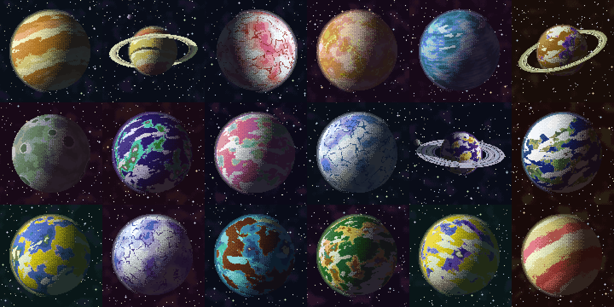
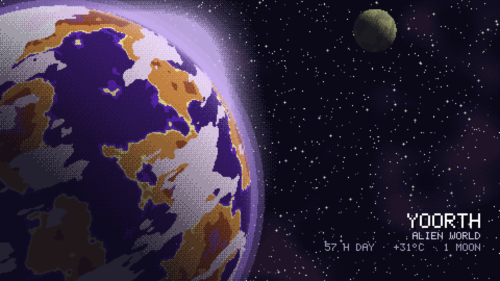
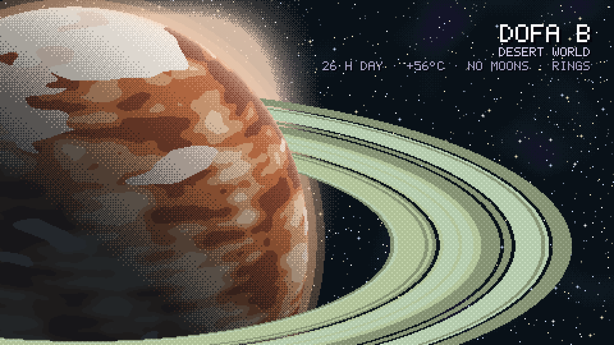
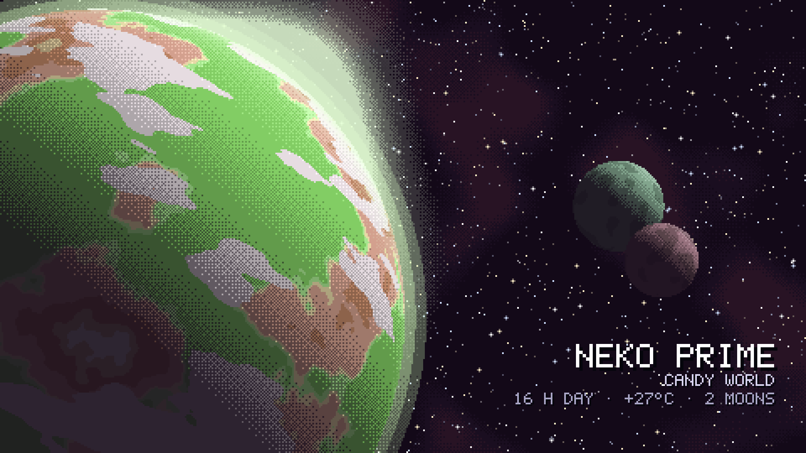
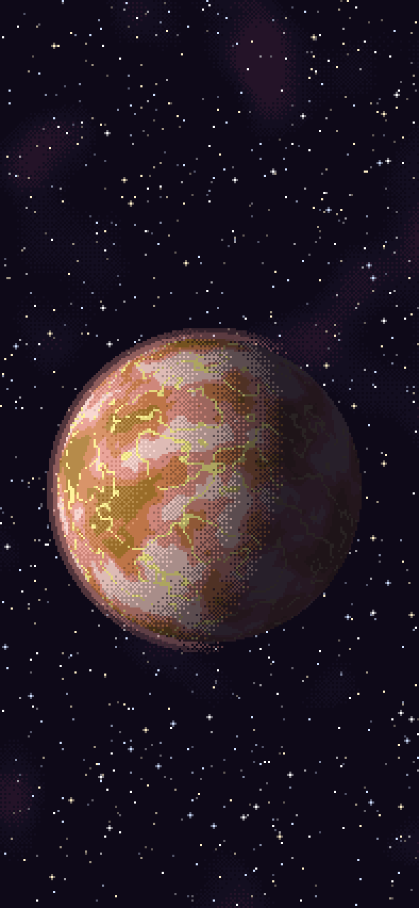
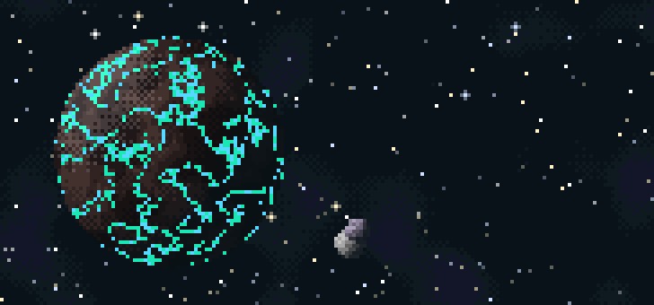

# 🪐 Pocket Planet

A brand-new pixel-art planet every time you look: on your **iPhone** as a widget
or lock-screen wallpaper, and on **Windows** as a desktop wallpaper that changes
**every time you unlock your PC**.

Every planet is generated from scratch, so you never see the same one twice:
alien worlds, crystal worlds, candy worlds, lava, ice, gas giants with storms,
rings and moons. Each one gets a name and some made-up facts.



## Windows

A huge, backlit planet, drawn at your screen's exact resolution so the pixels
stay sharp.



<p>
  
  
</p>

**Install**

1. You need **Node.js**. Open a terminal and run `node -v`. If it says it isn't
   found, install the LTS version from [nodejs.org](https://nodejs.org).
2. Download this repo: green **Code** button > **Download ZIP**, then unzip it.
3. Open `dist/windows` and double-click **`install.cmd`**. You get a first
   planet straight away.
4. Press **Win+L** and unlock: you get a new planet.

Also:

* `new-planet.cmd` gives you a new one right now.
* To stop it, run `install.cmd -Uninstall` from a terminal in that folder.
* If it says *Access is denied*, right-click `install.cmd` and choose **Run as
  administrator**.
* If something goes wrong, `%LOCALAPPDATA%\PocketPlanet\log.txt` says why.

## iPhone

<p>
  
  
</p>

It runs in [Scriptable](https://scriptable.app), a free app for JavaScript
widgets. Nothing is downloaded and nothing leaves the phone.

**Install**

1. Install **Scriptable** from the App Store.
2. Open [`dist/PocketPlanet.js`](dist/PocketPlanet.js), tap **Raw**, and copy
   all of it.
3. In Scriptable tap **+**, paste, and name the script `Pocket Planet`.
4. Tap ▶ to try it. A menu lets you preview the widget or save a wallpaper.

**Home-screen widget:** long-press the home screen, tap **Edit** > **Add
Widget** > **Scriptable**, then pick a size and add it. Tap the widget while
you're still editing and set **Script** to *Pocket Planet*. iOS refreshes
widgets every 5–15 minutes or so, and each refresh brings a new planet. Set
**Parameter** to `daily` if you'd rather have one planet per day.

**New lock-screen wallpaper automatically:** iOS can't run anything when you
unlock, but a Shortcuts automation can swap the wallpaper whenever you close an
app you use a lot.

1. **Shortcuts** > **+**, then build the shortcut:
   1. Add **Run Script** (Scriptable) > *Pocket Planet*, with "Run In App" off.
   2. Add **Base64 Encode**, then tap *Encode* and change it to **Decode**.
   3. Add **Set Wallpaper Photo** > **Lock Screen**, with the image set to
      *Base64 Encoded* and **Show Preview** off.
2. **Automation** > **+** > **App**. Pick apps you open all the time (TikTok,
   Messages…), choose **Is Closed**, turn on **Run Immediately** (on newer iOS:
   **Automation** on, **Notify** off), and add the actions above.

Your lock screen needs to be a **photo** wallpaper for this to work.

## How it works

Everything is plain JavaScript with no libraries:

* `planet.js` is the generator: 3D noise on a sphere, banded pixel-art
  shading with dithering, clouds, ice caps, city lights, rings with shadows,
  moons, a backlit glow, and a tiny PNG encoder.
* `scriptable-main.js` is the iPhone widget and wallpaper.
* `windows/` holds the Windows wallpaper script and installer.
* `preview.html` shows a grid of random planets in any browser.

After changing anything, rebuild `dist/` with:

```sh
node build.mjs
```
